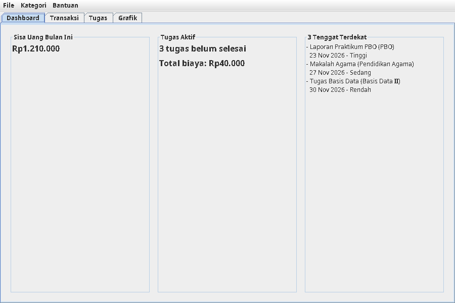
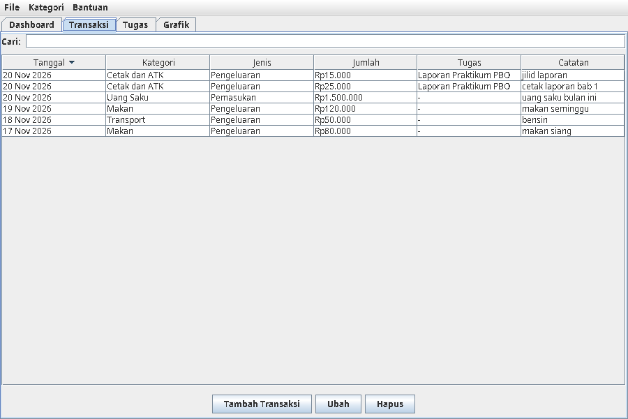
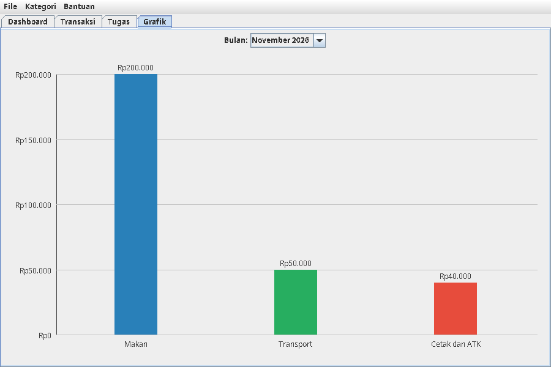

# Dompet Deadline

Aplikasi desktop Java Swing untuk mengatur uang dan tenggat tugas kuliah dalam satu tempat. Dibuat untuk Tugas 03 Praktikum PBO Kelas A.

Masalah yang diselesaikan sederhana: mahasiswa sering kehabisan uang dan waktu di akhir bulan secara bersamaan. Dompet Deadline mencatat pemasukan dan pengeluaran, lalu mengaitkan pengeluaran ke tugas kuliah, misalnya biaya cetak laporan, supaya terlihat berapa biaya sebenarnya dari setiap tugas.

## Tangkapan Layar





## Fitur

- **Transaksi**: tambah, ubah, dan hapus pemasukan atau pengeluaran. Setiap transaksi punya tanggal, jumlah, kategori, catatan, dan tugas terkait yang boleh kosong. Kategori bisa ditambah sendiri. Tabel bisa diurutkan dan dicari.
- **Tugas**: tambah, ubah, hapus, dan tandai selesai. Setiap tugas punya judul, mata kuliah, tenggat, dan prioritas tinggi, sedang, atau rendah. Tabel menampilkan total biaya yang sudah dikeluarkan untuk tiap tugas.
- **Dashboard**: sisa uang bulan berjalan (pemasukan dikurangi pengeluaran), tiga tenggat terdekat yang belum selesai, dan total biaya tugas yang masih aktif.
- **Grafik batang**: pengeluaran per kategori pada bulan yang dipilih, digambar sendiri lewat `paintComponent` tanpa pustaka grafik.
- **Pengingat tenggat**: Timer memeriksa berkala. Tugas yang belum selesai dan tenggatnya dalam 24 jam memicu notifikasi SystemTray, atau dialog kalau SystemTray tidak didukung. Setiap tugas hanya diingatkan sekali.
- **Ekspor CSV**: seluruh transaksi diekspor ke berkas CSV lewat dialog pilih lokasi, kolomnya tanggal, kategori, jenis, jumlah, tugas terkait, dan catatan.
- **Impor CSV** (bonus): transaksi dari berkas CSV bisa dimasukkan kembali, kategori yang belum ada dibuat otomatis.
- **Pencarian dan filter** (bonus): transaksi dan tugas bisa dicari lewat kotak pencarian di tiap tab.
- **Penyimpanan SQLite**: semua data tersimpan di SQLite lewat JDBC dan tetap ada setelah aplikasi ditutup. Berkas database ada di folder pengguna (`~/.dompet-deadline/dompet-deadline.db`), bukan di folder kode.
- **Build memakai Maven** (bonus): seluruh build, test, dan pembuatan JAR dijalankan Maven.

## Cara Menjalankan

Butuh JDK 21 atau yang lebih baru.

Unduh JAR dari halaman [Releases](https://github.com/dezzorigin/dompet-deadline/releases), lalu jalankan:

```bash
java -jar dompet-deadline.jar
```

Atau bangun sendiri dari kode sumber:

```bash
mvn package
java -jar target/dompet-deadline.jar
```

Unit test dijalankan dengan:

```bash
mvn test
```

## Struktur Proyek

```
src/main/java/dompetdeadline/
  Main.java                 titik masuk aplikasi
  model/                    kelas data: Transaksi, Tugas, Kategori, Jenis, Prioritas
  repository/               akses data dan koneksi SQLite
  service/                  logika: hitung sisa uang, total biaya tugas, tugas mendesak,
                            ekspor dan impor CSV, pengingat tenggat
  view/                     semua kelas Swing: jendela utama, dashboard,
                            transaksi, tugas, grafik, dialog
src/test/java/dompetdeadline/service/
  DompetServiceTest.java    unit test perhitungan
  CsvServiceTest.java       unit test ekspor dan impor CSV
```

Aturan teknis yang diikuti: tidak memakai `setLayout(null)`, uang disimpan sebagai `long` dalam rupiah (bukan `double`), SQL hanya ada di kelas repository, semua query dengan input pengguna memakai `PreparedStatement`, dan pembacaan database di jendela utama berjalan lewat `SwingWorker`.

## Lisensi

MIT, lihat berkas [LICENSE](LICENSE).
